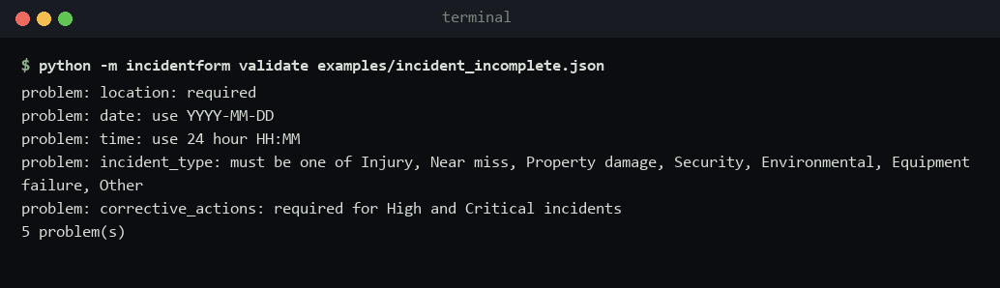

<p align="center"></p>

# incident-report-form

Incident reports get written in email, in chat, or on a paper form that nobody can search later. This repo keeps each incident as a small JSON record, checks that it is complete and consistent, and draws a clean one page PDF form from it. The PDF writer is part of the repo and uses only the Python standard library.



## What it is for

Facility coordinators, safety leads and supervisors need a report that has the same fields every time: when and where, who was involved, what was done, why it happened and who fixes what by when. This tool refuses a record with a bad date, an unknown severity, an action with no owner, or a High or Critical incident with no corrective action. A finished record becomes a PDF ready to sign and file.

## Install

```
git clone https://github.com/yassine2med/incident-report-form
cd incident-report-form && pip install -r requirements.txt
```

No third-party packages are needed. Python 3.10 or newer.

## How to use

| I want to | Command |
|---|---|
| Start a new record from a blank template | `PYTHONPATH=src python -m incidentform template > my_incident.json` |
| Check a record | `PYTHONPATH=src python -m incidentform validate examples/incident_slip.json` |
| Make the PDF form | `PYTHONPATH=src python -m incidentform render examples/incident_slip.json --out report.pdf` |
| Render even with problems (draft) | add `--force` |
| Show help | `PYTHONPATH=src python -m incidentform --help` |

Exit codes: 0 on success, 1 when the record has problems, 2 when the file is missing or is not valid JSON.

Example:

```
PYTHONPATH=src python -m incidentform validate examples/incident_incomplete.json
```

Output:

```
problem: location: required
problem: date: use YYYY-MM-DD
problem: time: use 24 hour HH:MM
problem: incident_type: must be one of Injury, Near miss, Property damage, Security, Environmental, Equipment failure, Other
problem: corrective_actions: required for High and Critical incidents
5 problem(s)
```

A complete record:

```
record is complete
```

`examples/incident_slip.pdf` is the PDF made from `examples/incident_slip.json`: a header with the incident number and a colored severity tag, detail fields, the story, tables for people and corrective actions, and signature lines. Long reports continue on more pages with a page number footer.

Run the tests with `python -m pytest -q`.

## How it works

1. `src/incidentform/report.py` loads the JSON and checks required fields, `YYYY-MM-DD` dates (not in the future), 24 hour times, the type and severity lists, action owners, due dates not before the incident, and corrective actions for High and Critical.
2. The layout code measures text with real Helvetica character widths so lines wrap inside the page, and starts a new page when a section does not fit.
3. `src/incidentform/pdf.py` writes the PDF 1.4 objects, cross reference table and trailer by hand. Text is left uncompressed so the file can be searched.

## Limits

- Text only, in a Latin character set (Western European accents work, other scripts print as question marks).
- No photos or attachments in the PDF.
- Incident types and severities are fixed lists in `src/incidentform/report.py`.
- It writes a form. It does not store incidents or send them anywhere.

## License

MIT. Yassine Emhamed, 2026.
